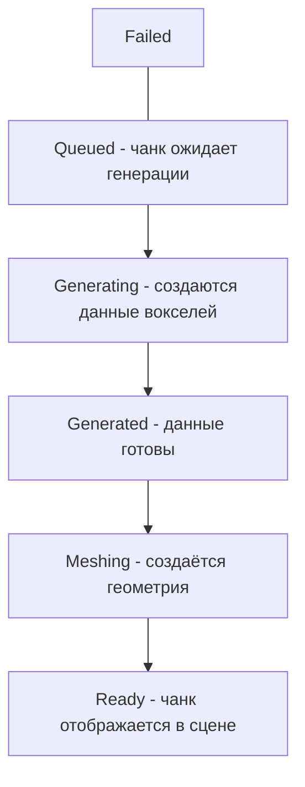
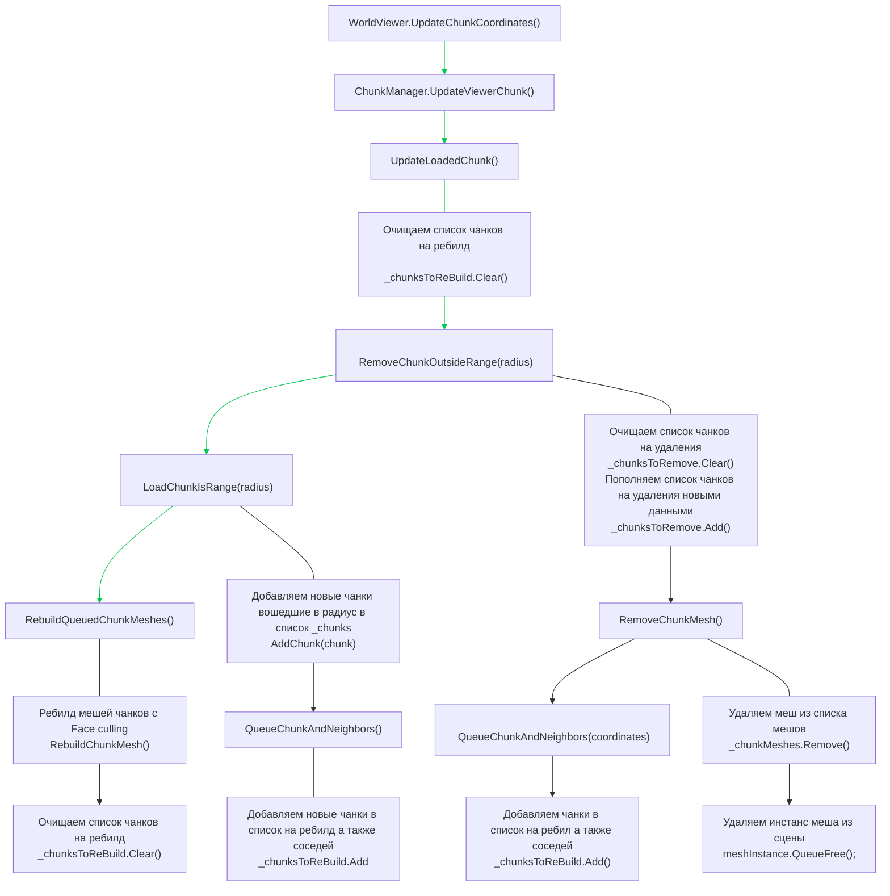

### Информация и представления об VoxelWorld системе

---
#### Файлы:
* Chunk.cs - Структура чанков
* ChunkGenerator.cs - Генерация вокселей из шумов
* ChunkManager.cs - управления чанками
* ChunkMesher.cs - Создание и удаления мешей чанков
* Voxel.cs - структура вокселей
* VoxelType.cs - Enum типов вокселей(например: воздух, трава, камень, грязь)
* WorldViewer.cs - Наблюдатель сцена за таргет

---
### Асинхронная работа ChunkManager

#### Жизненный цикл Chunk

> [!warning] Из любого рабочего состояния также возможен переход в Failed при ошибке.

---
#### Работа класса ChunkManager:

---